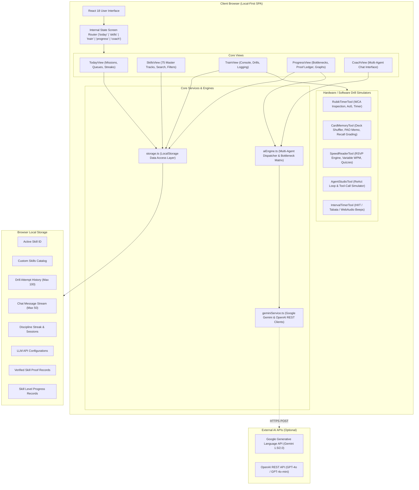
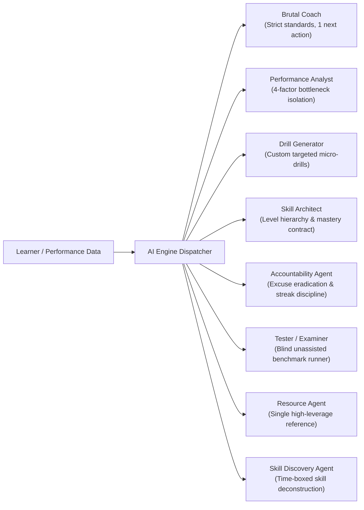

# SKILLFORGE // PROJECT ARCHITECTURE & SYSTEM OVERVIEW

**Version:** 1.0.0-audit  
**Date:** 2026-11-12  
**Audit Team:** Principal Software Architect, Senior Full-Stack Engineer, Security Engineer, QA Lead, Performance Engineer

---

## 1. Executive Concept & System Philosophy

**SKILLFORGE ("Train. Test. Master.")** is a personal deliberate-practice skill acquisition operating system. Its fundamental design thesis is:

> *"Don't teach me about the skill. Train me to perform the skill."*

Unlike conventional educational platforms that encourage passive video consumption, reading endless articles, and earning superficial gamified badges, SKILLFORGE treats learning as structured deliberate practice. Every skill in the catalog is bound to a strict, non-negotiable **Mastery Contract** defined by verifiable quantitative metrics (e.g., stopwatch splits, recall percentages, blindfold execution, deployed software repositories).

---

## 2. Technology Stack

| Layer | Technologies | Role / Notes |
| :--- | :--- | :--- |
| **Frontend Framework** | React 18.3.1 | Component-based UI with React Hooks and functional components. |
| **Language & Typing** | TypeScript 5.6.2 | Strict typing across domain models, drills, attempts, and agent messages. |
| **Build & Dev Tooling** | Vite 5.4.10 / 5.4.21 | ESM development server, Rollup production bundling, PostCSS. |
| **Styling & Design System** | Tailwind CSS 3.4.15 | Dark-mode terminal/industrial brutalist theme (`steel` + `forge` palettes). |
| **Icons & Typography** | `lucide-react` 0.460.0 | Minimalist iconography. JetBrains Mono & Inter typography via Google Fonts. |
| **State & Persistence** | LocalStorage API | Local-first client architecture; zero mandatory server dependencies. |
| **AI Integration** | Google Gemini 1.5/2.0 API & OpenAI API | Direct client-to-LLM REST integration with fallback to internal offline heuristic agents. |
| **Audio Synthesis** | Web Audio API | Client-side synthesizers for interval timers and cadence metronomes. |
| **Automation Scripts** | Python 3 | Data generation and transformation scripts (`generate_skills_data.py`, `build_full_skills_db.py`). |
| **Testing** | Vitest 2.1.0, React Testing Library, JSDOM | Comprehensive unit and integration test runner suite. |

---

## 3. High-Level System Architecture



---

## 4. Multi-Agent Coaching Core

The system models an offline-capable, multi-agent deliberate practice coaching team adhering to 15 strict rules of discipline (rejecting cheerleading, false praise, and passive lectures).



---

## 5. Domain & Curriculum Taxonomy (75 Master Tracks)

The curriculum encompasses 75 high-utility skills divided across 8 core domains:

1. **Domain A — Physical & Movement (10 Skills):** 5km sub-20m run, 10km endurance, sprint mechanics, 60s freestanding handstand, 20 consecutive pull-ups, muscle-up, front lever, pistol squats, full split mobility, jump rope double unders.
2. **Domain B — Speed & Dexterity (10 Skills):** Speedcubing sub-20s, Rubik's cube blindfolded, 3-ball juggling, 4-ball juggling, touch typing 100 WPM, blind touch typing, card flourishing/charlier cut, pen spinning, speed cup stacking, lockpicking.
3. **Domain C — Memory & Cognitive (10 Skills):** Memorizing 52-card deck in 5 minutes, 100-digit Pi recall, major mnemonic system, memory palace 50 loci, mental math (calendar calculation), mental multiplication, speed reading 600 WPM, speed reading 1000 WPM, blindfold chess tactics, lucid dreaming protocol.
4. **Domain D — Creative & Media (10 Skills):** AI-assisted song production (Suno/Udio), music theory songwriting, vocal pitch accuracy, piano chord progressions, digital video editing, smartphone cinematic B-roll, prompt engineering for visual art, 3D modeling fundamentals, screenwriting 10-minute short, stand-up comedy delivery.
5. **Domain E — Technology & AI (10 Skills):** Autonomous ReAct agent from scratch, tool-calling multi-agent swarm, fine-tuning open-source LLM, custom CLI developer tool, deploying micro-SaaS MVP in 24 hours, Webhook & REST API design, Git power rebasing, Docker container optimization, Vim/Neovim modal editing, reverse engineering network protocols.
6. **Domain F — Communication & Influence (10 Skills):** Zero-filler executive speech, 60-second elevator pitch, Chris Voss tactical negotiation, active listening mirroring, cold email copywriting, impromptu public speaking, conflict de-escalation, vocal projection, storytelling frameworks, persuasive slide deck design.
7. **Domain G — Practical / High-Utility One-Day Skills (10 Skills):** Adult/Child CPR & AED protocol, basic suture technique, emergency flat tire change, chef's knife sharpening, speed garment ironing, speed knot tying, emergency water purification, tax return fundamentals, basic electrical soldering, defensive driving maneuvers.
8. **Domain H — Challenge Protocols (5 Skills):** 1-Hour Skill Sprint, 5-Hour Intensive, 20-Hour Josh Kaufman acquisition engine, Ground-up deconstruction protocol, Unassisted Benchmark Gauntlet.

---

## 6. Directory Structure Overview

```text
/home/shiva/skills/
├── build_full_skills_db.py         # Python database generation script
├── generate_skills_data.py         # Python skill metadata compiler
├── data-source/                    # Source transcripts and specification transcripts
│   ├── conversation_full.txt       # Master product specification (Sections 1-31)
│   ├── resolved_chat.json          # Chat structured history
│   ├── script3.txt                 # Data scripts
│   └── script8.txt                 # Data scripts
├── dist/                           # Production build assets
├── docs/
│   └── audit/                      # Persistent audit documentation (10 files)
├── index.html                      # HTML5 entry with JetBrains Mono font imports
├── package.json                    # Dependencies, build & test scripts
├── postcss.config.js               # PostCSS configuration for Tailwind
├── src/
│   ├── App.tsx                     # Top-level application coordinator & modal mount
│   ├── index.css                   # Global Tailwind imports & CRT scanline styling
│   ├── main.tsx                    # React DOM bootstrap
│   ├── components/                 # Modals & navigation bars
│   │   ├── Navigation.tsx          # Responsive screen tab bar & streak indicator
│   │   ├── QuickLaunchModal.tsx    # "I Have 30 Min" time-boxed session dispatcher
│   │   ├── SettingsModal.tsx       # AI API provider (Gemini / OpenAI) configuration
│   │   ├── VisualHowToModal.tsx    # Step-by-step vector/SVG diagrams & pro tips
│   │   └── tools/                  # Interactive apparatus simulators
│   │       ├── AgentStudioTool.tsx # Autonomous agent ReAct & tool loop simulator
│   │       ├── CardMemoryTool.tsx  # 52-card deck shuffler & PAO recall grader
│   │       ├── IntervalTimerTool.tsx # HIIT / Tabata / Calisthenics Web Audio timer
│   │       ├── RubikTimerTool.tsx  # WCA official speedcube timer with Ao5 & inspection
│   │       └── SpeedReaderTool.tsx # RSVP speed flasher with comprehension quizzes
│   ├── data/
│   │   ├── domains.ts              # 8 domain specifications (DomainId, code, count)
│   │   └── skillsData.ts           # 75 comprehensive skill definitions (13,456 lines)
│   ├── services/
│   │   ├── aiEngine.ts             # Bottleneck analysis, multi-agent heuristics & session plans
│   │   ├── geminiService.ts        # Direct client-to-Gemini & OpenAI REST integration
│   │   └── storage.ts              # LocalStorage state management
│   └── views/
│       ├── CoachView.tsx           # Terminal-style multi-agent training chat
│       ├── ProgressView.tsx        # Four-factor matrix, Proof Ledger, attempt history
│       ├── SkillsView.tsx          # 75-skill curriculum catalog & custom skill creator
│       ├── TodayView.tsx           # Daily mission dashboard & discipline streak
│       └── TrainView.tsx           # Active training console & manual attempt logging
├── tailwind.config.js              # Custom steel/forge palette configuration
├── tsconfig.json                   # TypeScript strict compiler options
└── vite.config.ts                  # Vite bundler configuration
```
