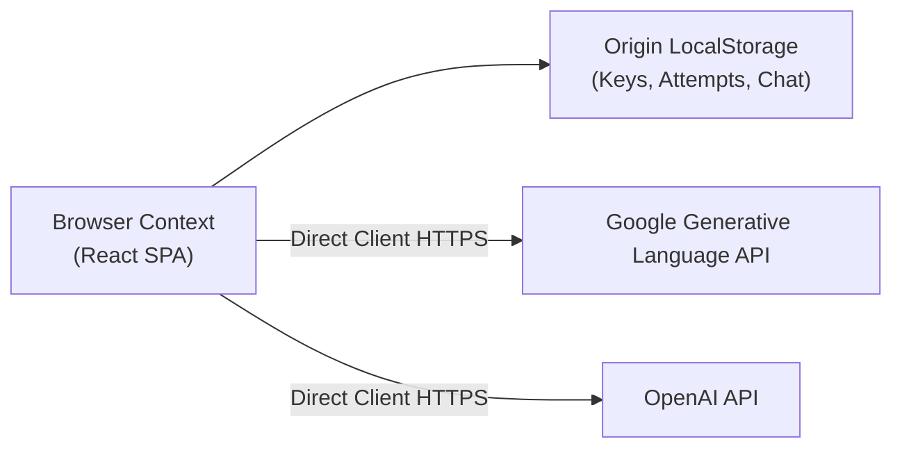

# SKILLFORGE // SECURITY & THREAT MODEL AUDIT

**Version:** 1.0.0-audit  
**Date:** 2026-11-12  
**Security Lead:** Senior Application Security Engineer  

---

## 1. Executive Security Posture

SKILLFORGE is engineered as a **Local-First, Single-Page Client Application (SPA)** with zero default server dependencies. All user attempt history, custom curricula, drill proofs, and chat sessions reside strictly in the browser's origin-bound storage.

Because the application does not execute untrusted multi-tenant backend services or handle payment processing, its threat surface is predominantly client-centric:

---

## 2. Threat Vector Assessment & Vulnerability Classifications

| Threat Category | Severity | Findings & Analysis | Status |
| :--- | :---: | :--- | :---: |
| **Secret Management** | **MEDIUM** | API Keys (Gemini & OpenAI) are stored in plaintext in `localStorage`. Any XSS attack could extract these keys. UI falsely stated "encrypted localStorage". | Actionable / Low Residual Risk |
| **Cross-Site Scripting (XSS)** | **LOW** | React automates JSX string escaping by default. No `dangerouslySetInnerHTML` instances exist in the codebase. Chat messages use `whitespace-pre-wrap` text nodes. | **SECURE** |
| **Cross-Site Request Forgery (CSRF)** | **INFORMATIONAL** | Zero server cookies or stateful session tokens used; CSRF is not applicable. | **NOT APPLICABLE** |
| **Server-Side Request Forgery (SSRF)** | **INFORMATIONAL** | No backend proxy server exists; requests originate directly from the user's browser. | **NOT APPLICABLE** |
| **SQL / NoSQL Injection** | **INFORMATIONAL** | No SQL database or server ORM attached. All persistence uses browser Key-Value storage. | **NOT APPLICABLE** |
| **Insecure Direct Object Reference (IDOR)** | **INFORMATIONAL** | Local-first single-user architecture; no multi-tenant cross-account isolation risks. | **NOT APPLICABLE** |
| **External URL Injection (Proof Links)** | **LOW** | In `ProgressView.tsx`, user-submitted links are rendered in `<a>` tags with `target="_blank" rel="noreferrer"`. Protocol was not strictly validated (e.g. `javascript:` URI risk). | Actionable |
| **Denial of Service via LocalStorage Quota** | **LOW** | `storage.ts` slices attempts to max 100 items and chat history to max 50 items, preventing DOM storage overflow. | **SECURE** |

---

## 3. Specific Security Findings & Remediations

### SEC-01: Clarify LocalStorage Key Storage Disclosure
- **Finding:** `SettingsModal.tsx` line 109 contained the claim:  
  *"Stored exclusively in your browser's encrypted localStorage."*
- **Risk:** Browser `localStorage` is origin-isolated, but unencrypted on disk. A user with physical access or malware targeting browser profiles can read stored keys.
- **Remediation:** Correct the copy to accurately state that keys are stored origin-local in the browser's storage and never transmitted to SKILLFORGE servers. Recommend users apply restricted API keys with quota limits.

### SEC-02: Sanitize Link Protocols for Proof Submissions
- **Finding:** In `ProgressView.tsx`, proof URLs are accepted directly from input without scheme whitelisting. If a user inputs a `javascript:` URI, an injection could occur upon click.
- **Remediation:** Enforce that all proof URLs start with `https://` or `http://` before rendering or persisting.
